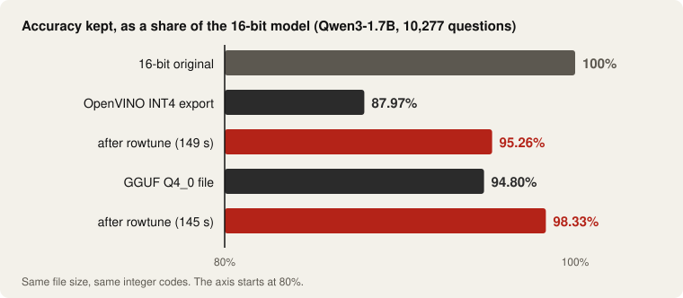
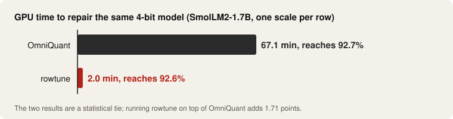

<h1 align="center">rowtune</h1>

<p align="center"><b>Win back most of the accuracy a model loses when it is shrunk to 4 bits, in about two minutes,<br>with a file of the same format, the same size and the same integer codes.</b></p>

<p align="center">
  <a href="#quick-start">Quick start</a> ·
  <a href="#what-you-can-do-with-it">What you can do with it</a> ·
  <a href="#results">Results</a> ·
  <a href="#how-it-works">How it works</a> ·
  <a href="#limits">Limits</a>
</p>

<p align="center"></p>

When a language model is shrunk to 4 bits so that it fits on a laptop or a small chip, it gets a bit worse at answering.
`rowtune` takes the 4-bit file you already have and the original model, and about two minutes later, on one GPU, gives you
back a file of exactly the same size that gets more answers right. It loads in the same runtime as before.

On Qwen3-1.7B, over 10,277 test questions:

- **GGUF Q4_0:** from 94.80% to 98.33% of the original model's accuracy, in 145 seconds.
- **OpenVINO INT4:** from 87.97% to 95.26%.

A 4-bit file stores a small integer for every weight and one scale for each row of weights. rowtune leaves every integer
where it is and adjusts only the scales, until the 4-bit model's predictions line up with the original's on ordinary text.
The model is not retrained. At the end the tool checks that not a single integer changed.

It does not help on GGUF Q4_K_M files, and it cannot rescue a model shrunk below 4 bits. The rest is under [Limits](#limits).

```
rowtune model-q4_0.gguf -o model-q4_0-rowtune.gguf --teacher path/to/16-bit-model
```

## Quick start

```
pip install -e .                                      # torch, numpy
pip install transformers huggingface_hub pyarrow      # to load the teacher and the default tuning text
```

One command per supported input:

```
# a llama.cpp GGUF file with Q4_0 weights
rowtune models/Qwen3-1.7B-Q4_0.gguf -o out/Qwen3-1.7B-Q4_0-rowtune.gguf --teacher models/qwen3-1.7b

# an OpenVINO IR folder with INT4 weights, one scale per channel
rowtune models/qwen3-1.7b-int4-channel -o out/qwen3-1.7b-int4-rowtune --teacher models/qwen3-1.7b

# a 4-bit safetensors checkpoint in the compressed-tensors layout (see Limits: not yet verified on a real release)
rowtune models/Qwen3-1.7B-quantized.w4a16 -o out/Qwen3-1.7B-w4a16-rowtune
```

Next to the output you get two small files: `<output>.rowtune.json` with the statistics and the result of the file check, and
`<output>.row_scales.pt` with the learned factors.

**The file check.** After writing, the tool reads both files again and compares them, and it stops with an error if a single
code byte, the structure or the size differs.

## What you can do with it

- **Upgrade the models you already run locally.** Point it at a Q4_0 GGUF file and load the result in the same runtime.
- **Get a better model onto an NPU.** OpenVINO's channel-wise INT4 format is the one its NPU path uses, and it is where I
  measured the largest gain: +4.13 points on the documented export.
- **Use it as the last step after another method.** It runs on top of GPTQ, AWQ or OmniQuant output and adds to them.
- **Aim it at your own domain.** Pass your own text with `--text-file`. Tuned on public Python code, a 4-bit release went from
  33.1% to 39.5% pass@1 on HumanEval and MBPP.
- **Add it to a release pipeline.** It needs two minutes and no labels, so it can run on every 4-bit build.
- **Study what rounding breaks.** `row_scales.pt` shows which rows of which layers had to move, and by how much.
- **Port it to another format.** The method fits any format that stores a real-valued scale next to the 4-bit codes. GGUF
  K-quants and MLX would be the next ones; see [Formats](#formats).

## Results

Everything below is on the same 10,277 questions from six zero-shot tasks (ARC-Easy, ARC-Challenge, HellaSwag, PIQA, WinoGrande,
LAMBADA). Differences are paired against the same file without the tuning, in points of mean accuracy, with 95% bootstrap
intervals over questions. "Kept" is the share of the 16-bit model's accuracy.

### Measured with this tool, end to end

One GPU each (RTX 5000 Ada), 26 November 2026, one run and one seed.

- **Qwen3-1.7B, GGUF Q4_0:** 145 seconds. +2.00 points [+1.43, +2.56]. Kept 94.80% → 98.33%. File size identical:
  1,129,782,944 bytes.
- **Qwen3-1.7B, OpenVINO INT4** (the documented AWQ + Scale Estimation export): 149 seconds. +4.13 points [+3.39, +4.85].
  Kept 87.97% → 95.26%. File size identical: 1,020,409,650 bytes.

The scores of the two input files come from my earlier runs of the same evaluation.

### Measured with the scripts this tool was built from

`REPRODUCE.md` gives the commands and says which of these I have not re-run with the tool.

- **Plain per-row rounding:** Qwen3-1.7B 82.4% → 94.7% kept; SmolLM2-1.7B 82.6% → 92.6%.
- **On top of GPTQ, per row:** Qwen3-1.7B 91.9% → 97.3% (+3.03 [+2.29, +3.79]; two repeat runs gave 95.0% and 94.9%);
  Qwen3-8B 94.9% → 97.9% (+2.00 [+1.36, +2.68]).
- **Published 4-bit releases:** Qwen3-1.7B +1.24 [+0.75, +1.71]; Qwen3-8B +1.13 [+0.72, +1.56], which leaves it at
  −0.20 [−0.72, +0.33] against 16-bit.
- **Three llama.cpp Q4_0 files:** +2.11, +1.17 and +1.25, all with intervals above zero. On Q4_K_M files the result is a tie.
- **Code** (HumanEval + MBPP, pass@1, tuned on public Python code): 33.1% → 39.5%, where 16-bit scores 42.0%. One run.
- **On a chip:** one run on Apple's Neural Engine, 500 LAMBADA items: 27.4% → 47.6%, against 50.6% for 16-bit on a GPU.

### Baselines on the same file

Run under a plan fixed in advance (`baselines/PLAN.md`; results and deviations in `baselines/REPORT.md`), on the
Qwen3-1.7B GGUF Q4_0 file, one run and one seed per arm.

- **One multiplier per row (rowtune):** 573,440 trained values, 98.33% kept.
- **One multiplier per 32-weight block:** 44,040,192 trained values (77 times more), 98.58% kept. The difference is
  -0.14 points [-0.60, +0.30], a tie within the margin set in advance, and the held-out KL is the same to three
  decimals (0.110).
- **The published closed-form least-squares multiplier**, with no training: 94.35% kept against 94.80% for the
  untouched file. It does not recover the loss here.

So on this file the restriction to one number per row costs no measurable accuracy, and the gain comes from tuning
end to end, not from fitting each layer separately. `rowtune ... --per-block 32` reproduces the per-block arm.

### Time

<p align="center"></p>

For a 1.7B model on one GPU, a run takes about 2 minutes on an existing 4-bit file and about 4 minutes from the original
weights. On the same model OmniQuant's official code took 67.1 minutes to reach 92.7%, while rowtune reached 92.6% in
2.0 minutes, which is a statistical tie. Run on top of OmniQuant, it added 1.71 points [+1.21, +2.24].

## How it works

**In plain words.** Rounding snaps every weight to one of 16 values. Each snap is a small error, and the errors add up as
the text passes through the layers. I leave the snapped values alone and move only the scale that each row already shares,
letting the 4-bit model and the original read the same text and adjusting the scales wherever their predictions differ.

**Precisely.** For every decoder linear layer I train one multiplier per output row, roughly 0.03% of the model's numbers, so
that the 4-bit model's next-token distribution matches the 16-bit teacher's. The loss is the KL divergence to the teacher,
the optimiser is Adam with learning rate 1e-3, and the default run is 600 windows of 1,024 tokens of unlabelled text, one
window per step (about 0.6 million tokens). The learned factors are then multiplied into the scales the file already stores
(float16 for GGUF and OpenVINO, the stored type for safetensors), and nothing else is written.

Tuning text: `--text-file` or `--parquet`; by default a WikiText-103 training shard, downloaded.

`rowtune round --model M --out DIR` rounds a 16-bit model to 4 bits per row, tunes it, and writes a 16-bit checkpoint of the
result. Python entry points: `rowtune.core.attach_row_scales`, `rowtune.tune.tune`, `rowtune.core.fold_row_scales`,
`rowtune.upgrade.upgrade`, `rowtune.formats.{gguf,openvino,ct}`.

## Formats

- **Supported and tested with this tool:** llama.cpp GGUF Q4_0, and OpenVINO INT4 with one scale per channel.
- **Next, not yet tested:** GGUF K-quants such as Q4_K_M, whose scales are stored in 6 bits, so a tuned scale has to be rounded
  again and part of the gain may be lost; and MLX 4-bit.
- **Does not fit as it stands:** formats that store a codebook instead of a scale (palettised Core ML, the GGUF IQ types).

## What has been checked, and what has not

- **Tests** (104, no GPU, no download): on tiny synthetic files of each format, codes are bit-identical, scales changed,
  structure and byte size unchanged, the file loads again, and the upgraded file is closer to the teacher than the input.
  Run them with `python -I -m unittest`.
- **Real files, end to end:** the two results above. All 196 linear layers were handled in both files.
- **In llama.cpp:** the upgraded Qwen3-1.7B Q4_0 file (checksum identical to the scored file) loads in llama.cpp
  (`llama-cli`, build 11669) on an Apple M2 Max, is recognised as Q4_0 and answers three test prompts correctly at about
  190 tokens per second. This shows that the file loads and answers; I did not benchmark it there.
- **Not run yet:** the safetensors layout on a real release (it is written from library documentation); a second seed.

## Limits

- **Four bits is the floor.** At 2 bits SmolLM2 keeps 48.8% of 16-bit accuracy, where random answers give 48.1%. At 3 bits per
  row it keeps 64.2%.
- **GGUF:** only Q4_0 tensors are read and patched. A linear weight stored in another type is left byte-identical and, during
  tuning, stands in as the 16-bit teacher weight, so results on such files can differ from the numbers above.
- **OpenVINO:** symmetric INT4 with one float16 scale per output channel. Asymmetric constants are skipped. RMSNorm gains are
  read from the graph, so an AWQ export's folded gains are used.
- **Safetensors:** scales are stored in float16 or bfloat16, so the written factor is rounded (relative error up to 0.05% and
  0.4%).
- **Mostly GPU evaluation.** Apart from the one Neural Engine run, the accuracy numbers come from running the rounded weights
  on a GPU rather than through integer kernels.
- **Small sample of models.** Three models (SmolLM2-1.7B, Qwen3-1.7B, Qwen3-8B), one family of tuning text, and one run per
  result except where repeats are stated. Repeated runs vary by up to 2.4 points of kept share.
- **A variant is not included.** A further version of the method scores slightly higher but does not fit a stock 4-bit file
  format, so I left it out and make no claim for it.
- **Baselines cover one file.** The comparison with per-block scale training and with the closed form was run on one
  GGUF file with one seed. DWQ itself was not run: the per-block arm is a DWQ-style parametrisation, without biases,
  trained with this tool.
- The 4-bit rounding in `rowtune round` is my own implementation and has not been checked bit for bit against other tools.

## How this relates to other work

Tuning the scales of a quantised model against the full-precision model, with the integer codes left alone, is an
established idea: MLX-LM's DWQ does it for MLX files, and ThinkBit (arXiv 2610.34886) uses it as one stage at 2 bits.
rowtune is the simplest form of it that I know of: a single multiplier per output row and nothing else, trained
against the 16-bit model and written in place into GGUF Q4_0 and OpenVINO INT4 files that already exist, with a
byte-by-byte check that no code changed. AlphaTuning (arXiv 2210.03858) used the same one-per-row restriction to adapt
models to tasks; I have not found it used this way, to repair an existing 4-bit file.

It is also a different thing from fixing each layer's scales separately. The OpenVINO export in the results had
already been through OpenVINO's own Scale Estimation, and rowtune added 4.13 points on top of it.

## Contributing

Ports to other formats would help most. A format reader has to find each linear layer's codes and scales, write new scales
back without touching anything else, and pass the file check. The GGUF and OpenVINO readers in `rowtune/formats/` are short
and can serve as a pattern.

## AI assistance

An AI assistant (Claude) helped write the code, tests and documentation in this repository. The tool, the experiments and
the numbers are my own work.

## Paper

A short paper with the method, the measurements, related work and the machine-checked statements:
DOI [10.5281/zenodo.24557644](https://doi.org/10.5281/zenodo.24557644) (always the latest version; version 2 adds the
baselines). The Lean file is in `lean/`.

## Licence

Apache-2.0, see `LICENSE` and `NOTICE`. Copyright 2026 Alexandra Zhuravlyova.
